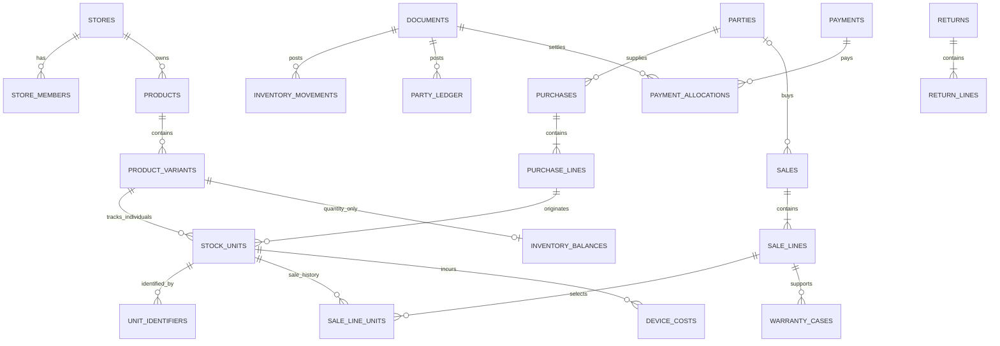

# 03 — Thiết kế dữ liệu đề xuất

Đây là mô hình logic và ràng buộc cần triển khai sau phê duyệt, **không phải SQL/migration**. Chính sách D02/D03/D04/D06/D08 phải chốt trước schema thực thi. UUID làm khóa chính, không dùng IMEI/Serial/SKU làm PK.

**Nền database đã được người dùng chốt: Supabase PostgreSQL.** IndexedDB trên máy quầy chỉ phục vụ bán offline và chờ đồng bộ theo kế hoạch; sổ dữ liệu trung tâm nằm trên Supabase. Chưa tạo bảng hoặc thay đổi database thật.

## 1. Quy ước chung

- Bảng nghiệp vụ có `id`, `store_id`, thời gian server, người tạo; các bảng con giữ `store_id` và FK cùng cửa hàng. `auth.users.id` chỉ định danh người đăng nhập; thông tin vai trò đặt ở `store_members`.
- Dùng `UNIQUE(store_id, id)` ở bảng cha và FK ghép `(store_id, parent_id)` ở bảng con để không gắn hàng của cửa hàng A vào hóa đơn B. UUID duy nhất toàn hệ thống không thay thế ràng buộc này.
- Giá bán/thu/chi VND không âm, số nguyên; giảm giá không vượt cơ sở tính. Vốn trung gian/giá trị kho dùng `numeric(20,6)` đề xuất, không `float`. Số lượng nguyên; hàng cân/đo không nằm MVP.
- Thời gian lưu `timestamptz`; hiển thị và chốt khoảng ngày theo Asia/Ho_Chi_Minh. `document_date` không thay `posted_at` để tính giá vốn hồi tố. Mã hiển thị có số thứ tự duy nhất theo cửa hàng/loại/kỳ; chấp nhận khoảng trống do rollback, không yêu cầu số liên tục tuyệt đối.
- `DRAFT`, `POSTED`, `CANCELLED` cho chứng từ; CANCELLED chỉ dùng nháp. Chứng từ đã ghi sổ không xóa/sửa tiền, dòng, đối tác hay ngày ghi sổ. Đảo bằng chứng từ khác và liên kết; dữ liệu tham chiếu danh mục dùng soft archive, không cascade xóa lịch sử.
- Tên, SKU, giá, giảm giá, thuế nếu áp dụng, mô tả tình trạng và điều kiện bảo hành cần snapshot tại chứng từ. Đổi tên sản phẩm không làm thay đổi hóa đơn cũ.

## 2. Quan hệ chính

Sơ đồ chỉ minh họa quan hệ chủ đạo; các FK của trả hàng, tài khoản công nợ và nguồn ghi sổ được mô tả bên dưới. `documents` là header nhỏ dùng chung cho số phiếu, loại và nguồn sổ, không phải workflow engine hay mô hình kế toán tổng hợp.

## 3. Cửa hàng, danh mục, đối tác

| Bảng | Trường chính / nội dung | Ràng buộc quan trọng |
|---|---|---|
| `stores` | tên, tiền tệ VND, timezone, trạng thái, mốc khóa kỳ, trạng thái tạm dừng ghi kho khi kiểm kê | Không dùng cài đặt client làm nguồn thời gian/quyền |
| `store_members` | store_id, user_id, role, active | Unique store/user; user FK Auth; chỉ chủ được đổi quyền; không tự xóa chủ cuối cùng |
| `categories`, `brands` | tên, mã, archived | Unique mã trong cửa hàng, quan hệ danh mục đơn giản; không phân cấp vô hạn |
| `products` | category_id, brand_id, tên/mẫu, mô tả, ảnh tùy chọn | Lưu nhóm/loại điện thoại để bắt buộc mode IMEI |
| `product_variants` | product_id, SKU, barcode tùy chọn, màu, dung lượng, phiên bản, tracking_mode, giá bán/nhập tham khảo, min_stock, archived | Unique store/SKU đã chuẩn hóa; barcode unique khi có nếu D08 duyệt một barcode một SKU; mode bất biến sau phát sinh |
| `parties` | mã, tên, điện thoại tùy chọn, địa chỉ tối thiểu, is_customer, is_supplier, archived | Unique store/mã; không unique số điện thoại vì có thể dùng chung; có ít nhất một vai trò |

Phân loại điện thoại mới/cũ ở `stock_units.condition`; không tách thành hai hệ thống sản phẩm. Có thể tách SKU bán nếu cửa hàng cần bảng giá/cách tìm riêng; vẫn chỉ một unit và một lịch sử. SKU/barcode lưu text giữ số 0 đầu. Quy tắc chuẩn hóa SKU và Serial theo D08; khóa unique dùng giá trị chuẩn hóa, không chỉ kiểm tra trên UI.

## 4. Định danh và kho

| Bảng | Trường và mục đích | Kiểm soát |
|---|---|---|
| `stock_units` | variant_id, origin_purchase_line_id hoặc opening_line_id, condition, mô tả tình trạng, ownership_status, stock_status, current_cost, version | Chỉ IMEI/SERIAL; đúng một nguồn nhập đầu tiên; thêm OFFLINE_RESERVED cho đơn vị đã cấp quyền bán quầy, không bán online ở máy khác |
| `unit_identifiers` | unit_id, kind IMEI/SERIAL, slot IMEI_1/IMEI_2/SERIAL, raw_value, normalized_value | Unique `(store_id,kind,normalized_value)` và `(store_id,unit_id,slot)`; không unique theo slot khiến IMEI1 trùng IMEI2 lọt |
| `inventory_balances` | variant_id, available_qty, offline_reserved_qty, quarantine_qty, repair_qty nếu có nhu cầu, total_value, version | Chỉ QUANTITY; unique store/variant; lượng từng bucket ≥0; Q gồm cả quota offline còn trên sổ trung tâm; Q=0 thì V=0 |
| `inventory_movements` | document_id, document_line_ref, variant_id, unit_id nếu có, from_bucket, to_bucket, quantity, value_delta, posted_at, thứ tự | Append-only; chuyển lượng phải dương; serialized lượng=1/unit; QUANTITY không có unit; điều chỉnh chỉ giá trị lượng=0; phân biệt external/sở hữu/bucket |

IMEI 1 bắt buộc và IMEI 2 tùy chọn cho máy; cả hai có kind IMEI để chống trùng chéo. Serial dùng kind SERIAL và không được đưa vào slot IMEI. Không cho hai IMEI giống nhau trên một máy. IMEI đề xuất đúng 15 chữ số và kiểm tra checksum ở bước xác thực; dữ liệu sai/ngoại lệ phải có quy trình chủ duyệt trước chuyển đổi, không âm thầm bỏ kiểm tra. Serial phải chốt cách trim/hoa thường/ký tự; không dùng quy tắc IMEI cho Serial.

Số lượng định danh và quan hệ kind/mode kiểm tra bằng constraint trigger hoặc hàm ghi sổ kết hợp quyền không DML trực tiếp; CHECK trên một dòng không tự kiểm tra bảng khác. Có thể lưu nháp chưa đủ mã; khi POSTED phải đủ IMEI1/Serial và đúng số đơn vị. Mã đã có lịch sử không được tự gán sang unit khác. Máy trả và bán lại giữ nguyên unit_id, không xóa unique rồi tạo máy mới.

Đối với hàng lượng, `inventory_balances` là projection cập nhật nguyên tử cùng sổ; có thể tái đối soát. Đối với IMEI/SERIAL, tồn tính từ trạng thái các unit và đối chiếu movement, **không dùng thêm một bộ số dư serialized độc lập**. Tổng nhập/xuất vẫn tính từ movements cho cả ba mode. Online chỉ bán AVAILABLE; quầy bán phần OFFLINE_RESERVED đã cấp riêng. Hàng QUARANTINE/REPAIR còn sở hữu nhưng không được bán. Số trung tâm chưa phản ánh hàng đã giao offline trước sync, phải hiển thị mốc cập nhật/phạm vi thiếu. Hàng khách gửi bảo hành không tăng tồn sở hữu.

Movements biểu diễn nhận hàng, bán, trả, chuyển trạng thái, hủy và điều chỉnh giá trị. Chuyển bucket nội bộ có value_delta tổng bằng 0; điều chỉnh vốn có lượng 0 qua loại movement riêng được kiểm soát, không giả làm nhập số lượng. Bảng movement cần quy tắc CHECK tách loại chuyển lượng (quantity>0) và điều chỉnh giá trị (quantity=0, value_delta khác 0), không dùng một CHECK lượng dương cho mọi loại.

## 5. Chứng từ mua, bán, trả và chi phí

| Bảng | Nội dung trọng yếu |
|---|---|
| `documents` | id/store, document_type, code, status, document_date, posted_at, actor, operation, request_id, is_command_root, root_document_id cho chứng từ con, original_document_id khi đảo, reason, version. Unique store/type/code; unique có điều kiện store/operation/request_id chỉ cho is_command_root=true |
| `purchases` | PK/FK document_id, supplier_party_id, nguồn NCC/khách bán, tổng trước/sau giảm, chi phí vốn hóa, tổng phải trả NCC hàng; không cộng chi phí bên thứ ba vào sai đối tác |
| `purchase_lines` | purchase_id, variant_id, quantity, đơn giá mua, line_discount, header_discount_allocated, landed_cost_allocated, total_cost, snapshots |
| `purchase_charges` | purchase_id, đối tác nhận chi, loại chi phí, số tiền, phần vốn hóa, linked_payment_id/cost_document_id; phân bổ xuống dòng và unit trong transaction |
| `sales` | PK/FK document_id, customer_party_id nullable chỉ khi trả đủ, tổng tiền/giảm/thuế theo D03, net_revenue, payable_total, chính sách snapshot |
| `sale_lines` | sale_id, variant_id, quantity, đơn giá, giảm giá dòng/phiếu phân bổ, net_revenue, tax nếu có, cogs_snapshot, warranty_snapshot |
| `sale_line_units` | sale_line_id, unit_id, cogs_at_sale, snapshot tình trạng, giá trị doanh thu phân bổ nếu cần khác giá; một unit chỉ một lần trong một sale |
| `returns` | PK/FK document_id, direction SALE_RETURN/PURCHASE_RETURN, original_document_id, party_id, giá trị trả, phí được duyệt nếu có, exchange_group_id tùy chọn |
| `return_lines` | return_id, original_sale_line_id hoặc original_purchase_line_id, unit_id nếu theo đơn vị, quantity, revenue_or_credit_reversed, tax_reversed, original_cogs_returned, inventory_value_removed, variance, destination_bucket |
| `device_costs` | document_id, unit_id, loại chi phí, amount, incurred_at, recognized_at, BEFORE_SALE_CAPITALIZED/AFTER_SALE_COGS_ADJUSTMENT/WARRANTY_EXPENSE theo D06, sale_line_unit_id khi liên quan, nguồn thanh toán/công nợ |

Mỗi header con cùng PK với `documents`; loại chứng từ phải khớp, kiểm tra trong transaction/trigger. `document_line_ref` trong sổ phải là FK hợp lệ, không chỉ cặp text “tên bảng + id” không được kiểm chứng. Đề xuất dùng các cột FK nguồn dòng rõ ràng (purchase_line_id, sale_line_id, return_line_id, adjustment_line_id, opening_line_id, device_cost_id), CHECK đúng một nguồn theo loại; các header dùng document_id chung. Chốt thiết kế vật lý này ở giai đoạn 1 để tránh “tham chiếu đa hình” mồ côi.

Một lệnh có thể sinh nhiều chứng từ: bán kèm hai khoản thu, hoặc đổi hàng gồm trả+bán+thu/hoàn. Chỉ một chứng từ là gốc lệnh; các chứng từ con liên kết root_document_id cùng cửa hàng và được commit cùng lệnh. Không đặt unique request_id trên tất cả chứng từ con vì sẽ chặn thanh toán kết hợp/đổi hàng hợp lệ. Kết quả idempotency trả chứng từ gốc và các mã con được phép xem.

Tổng tiền header = tổng các dòng theo quy tắc làm tròn; số unit = quantity cho mode serialized; không lặp unit trong giỏ; dòng trả trỏ đúng loại dòng gốc và cùng SKU/cửa hàng/đối tác. Các ràng buộc tổng nhiều dòng phải kiểm tra phía DB khi ghi sổ và hạn chế quyền sửa sau đó, không mô tả chúng như CHECK đơn dòng.

`sale_line_units` cho phép một unit xuất hiện ở nhiều lần bán trong lịch sử sau khi trả. Vì vậy **không UNIQUE(unit_id) toàn lịch sử**. Bán trùng được ngăn bằng khóa và trạng thái unit, cộng unique trong một lần bán; lần xuất đang hoạt động gắn unit.current_sale_line_unit_id để kiểm tra/tra cứu nếu triển khai trường này. Khi trả phải tham chiếu chính lần bán đang đủ điều kiện trả, không chỉ dựa trên unit_id.

`return_lines` chứa các trường tiền theo loại: trả bán hoàn vốn snapshot; trả nhập hàng lượng giảm giá trị kho theo bình quân hiện tại và ghi variance so với credit NCC. Không dùng một trường giá trị cho hai nghĩa. Trả nhiều lần khóa dòng nguồn và cộng lượng đã trả; lần cuối nhận phần dư tiền/vốn. Đổi hàng dùng nhóm liên kết trả+bán và thu/chi chênh lệch, không ghi đè unit cũ bằng unit mới.

## 6. Thu/chi, nghĩa vụ và phân bổ

| Bảng | Nội dung | Ràng buộc |
|---|---|---|
| `payments` | PK/FK document_id, party_id, account_side AR/AP, direction IN/OUT, method CASH/BANK, amount, reference, paid_at, purpose RECEIPT/PAYOUT/REFUND/ADVANCE/REVERSAL | amount>0; phương thức rõ; mỗi phần tiền mặt/chuyển khoản là một payment; chiều tiền phù hợp nghiệp vụ |
| `party_ledger` | document_id, party_id, account_side, signed_amount, event_type, posted_at, allocation reference nếu cần | Append-only; signed_amount theo bảng dấu trong 02; unique nguồn/sự kiện để chống ghi đôi |
| `payment_allocations` | source_document_id (payment hoặc chứng từ credit trả hàng), payment_id khi source là payment, target_document_id, party_id, account_side, amount, allocation_kind, reversal_of_id | amount>0; nguồn/đích cùng store/party/account; kind phân biệt thanh toán nợ, credit giảm nợ, hoàn credit và đảo phân bổ |

Tên `payment_allocations` ở mô hình logic bao gồm cả **phân bổ credit trả hàng**; tên vật lý có thể là `settlement_allocations` nếu dễ hiểu hơn khi thiết kế chi tiết, nhưng chỉ dùng một bảng/hợp đồng thống nhất sau khi chốt. Không tạo thêm tiền thu giả để sử dụng credit trả hàng. Mỗi phân bổ có nguồn có thật và target có thật qua document FK; FK payment phải khớp source_document_id khi có.

Sổ công nợ ghi **tổng nghĩa vụ** của chứng từ và **từng biến động tiền/credit**, không chỉ ghi số còn nợ sau thu ngay. Nhờ đó có thể tái tính: số dư AR/AP đối tác = tổng signed_amount trong tài khoản đó. Phân bổ dùng để tính phần chưa tất toán từng chứng từ; không cộng thêm một lần nghĩa vụ khi phân bổ.

Khóa cả các nguồn/đích phân bổ, kiểm tra tổng phân bổ chưa đảo không vượt nguồn và phần nợ/credit đích phù hợp. Không hard delete allocation; bản đảo liên kết bản gốc và không được đảo quá phần đã phân bổ. Tiền hoàn khách không vượt credit phải trả đã duyệt, tiền nhận NCC hoàn không vượt credit bên NCC. Nếu cho ứng trước, lưu phần chưa phân bổ riêng, không làm giả nợ âm một hóa đơn.

Không bắt buộc tồn tại bảng “debts” lưu dư độc lập. `party_ledger` là sổ nguồn, số dư chứng từ là phép tính từ nghĩa vụ/credit/phân bổ; có thể dùng view/RPC. Nếu cần cache số dư để tăng tốc, cập nhật cùng transaction và có đối soát, không cho người dùng nhập trực tiếp dư nợ.

## 7. Bảo hành, kiểm kê và kiểm soát

| Bảng | Nội dung và điều kiện |
|---|---|
| `warranty_cases` | sale_line_id, sale_line_unit_id hoặc quantity, unit_id nullable, party_id, tiếp nhận/kết quả, tình trạng gửi, ownership CUSTOMER/STORE, chính sách snapshot, chi phí liên kết. Theo dõi lượng đang xử lý tránh nhận lặp vượt quyền lợi hàng lượng; mỗi lần đổi trạng thái/kết quả ghi audit để giữ lịch sử xử lý |
| `stocktakes`, `stocktake_lines` | thời điểm/số thứ tự chụp sổ, SKU/unit, lượng hệ thống, lượng đếm, chênh lệch, người đếm/duyệt, trạng thái nháp/đã duyệt; không lưu “số mới” rồi ghi đè balance |
| `inventory_adjustments`, `inventory_adjustment_lines` | document_id, stocktake_id tùy chọn, nguồn hàng, lượng/giá trị tăng giảm, lý do, người duyệt; số dư sau điều chỉnh không âm |
| `opening_documents`, `opening_lines` | header theo documents, ngày chuyển đổi, unit/variant/quantity/value hoặc party/AR/AP balance; không làm tăng mua/bán/thu/chi của kỳ mới |
| `audit_events` | actor, store, action, document/object ref, request_id, server_time, lý do, thay đổi đã lọc thông tin nhạy cảm; append-only, không lưu mật khẩu/token |
| `idempotency_requests` | store_id, operation, request_id, actor_id, canonical_payload_hash, result_document_id/result_projection, created_at | Unique store/operation/request_id; so hash và quyền trước trả kết quả; ghi kết quả cùng transaction |

Audit thành công đi cùng nghiệp vụ. Thất bại đã rollback không thể lưu bền trong cùng transaction; lỗi quyền/lỗi kỹ thuật cần log riêng đã lọc dữ liệu và request_id, không khẳng định audit DB chứa tất cả lần thất bại. Không expose kết quả idempotency chứa giá vốn cho nhân viên không có quyền.

## 8. Transaction và xử lý đồng thời

Các lệnh ghi sổ nhập/bán/trả/thu chi/phân bổ/chi phí/kiểm kê/đảo đều là một RPC có transaction riêng. Luồng chung:

1. Xác thực người dùng và membership hiện tại; khóa quyền theo quy tắc trong 05 để thu hồi quyền có thứ tự rõ. Giữ khóa idempotency và so nội dung.
2. Khóa phạm vi cửa hàng/kỳ/kiểm kê khi cần; kiểm tra không bị khóa ghi. Khóa các chứng từ nguồn/cần tất toán theo ID tăng dần; tài khoản đối tác; terminal/grant/lines nếu có; các biến thể và balance; cuối cùng units theo ID trong mỗi nhóm. Mọi RPC, kể cả cấp/release quota và sync, dùng cùng thứ tự.
3. Đọc lại giá/quyền/mode/trạng thái/lượng và tổng đã trả/phân bổ sau khóa. Với hàng lượng mới, tạo sẵn balance lúc tạo variant để luôn có dòng khóa; với serialized khóa variant làm điểm ổn định cho đổi mode/kiểm kê, không tạo balance serialized.
4. Tính tiền/vốn tại server. Ghi tất cả header/detail/unit/movement/ledger/payment/allocation/audit/result, kiểm tra tổng và commit. Không gọi API ngoài, in hoặc upload trong transaction.
5. Lỗi rollback toàn bộ. Retry deadlock/serialization hữu hạn giữ nguyên request_id; lỗi nghiệp vụ yêu cầu người dùng sửa. Client timeout phải tra lại kết quả cùng khóa.

Read Committed kèm row locks và constraints là đề xuất mặc định. Chỉ nâng Serializable cho luồng được chứng minh cần, có xử lý retry; không dựa riêng vào isolation để tránh xuất âm. Membership active cùng store/role không được lấy từ payload.

Hàng lượng trừ tổng lượng theo variant trên toàn giỏ, không kiểm từng dòng riêng khiến hai dòng cùng SKU vượt tồn. Online chỉ xuất AVAILABLE; sync quầy chỉ xuất OFFLINE_RESERVED thuộc grant đúng terminal và còn quyền sau khóa. Unique định danh chống nhập trùng đồng thời, kể cả hai màn hình trước đó cùng báo chưa có mã.

Ràng buộc bền trên documents chống ghi lại cùng request_id ngay cả sau dọn payload idempotency. Không xóa dấu chống trùng của giao dịch đã ghi sổ trong thời gian còn khả năng gửi lại; chính sách lưu trữ cần giữ reference và hash tối thiểu. Cùng request_id khác payload luôn từ chối, không tạo hóa đơn mới.

## 9. Khóa và index dự kiến

| Index / ràng buộc | Mục đích |
|---|---|
| unique store/user trên membership | Kiểm tra quyền nhanh |
| unique store/SKU; barcode unique khi có | Tra hàng, chống mã trùng |
| unique store/kind/identifier; unit/slot | Tra định danh và trùng chéo IMEI |
| stock_units(store,variant,status), current_sale link khi có | Tồn khả dụng, khóa đơn vị |
| balances unique store/variant | Một điểm khóa cho phụ kiện lượng |
| documents(store,type,posted_at,id), unique code/request | Tra theo ngày, phân trang ổn định, chống trùng |
| dòng theo document; sale_line_units theo unit/lần bán | Truy lịch sử và kiểm trả |
| returns theo original_document; return_lines theo dòng gốc | Tính lượng/tiền đã trả |
| movements(store,variant,posted_at,id), unit khi có | Sổ kho và lịch sử đơn vị |
| ledger(store,party,account_side,posted_at,id) | Nợ và đối soát |
| allocations theo source/target, payments theo party/date | Đối soát tiền/chứng từ |
| audit(store,created_at,id), actor khi cần | Tra thao tác |

PostgreSQL không tự tạo index cho mọi cột FK ở phía con; tạo các index phục vụ join/xóa kiểm tra sau đo query thực tế. Không tạo index cho mọi cột hoặc partition khi chưa có số liệu tải. Tìm kiếm tên có thể bắt đầu với tìm tiền tố/chuỗi đã chuẩn hóa; nếu cần tiếng Việt không dấu/fuzzy, đánh giá khả năng PostgreSQL rồi đo trước khi thêm dịch vụ tìm kiếm ngoài.

## 10. Toàn vẹn, quyền và đối soát

- FK lịch sử dùng RESTRICT/NO ACTION; soft archive danh mục/đối tác. Không cascade xóa chứng từ tài chính hoặc Auth user làm mất audit.
- Quyền client không DML trực tiếp các bảng sổ, balance, unit status, payment, idempotency và chứng từ POSTED; chỉ RPC có quyền kiểm soát. Chỉnh nháp cũng kiểm version để tránh hai tab ghi đè.
- RLS giới hạn cửa hàng, không che cột giá vốn. API nhân viên dùng projection an toàn; cost/profit qua RPC có kiểm quyền; xem thêm 05.
- Đối soát kho lượng: Q theo từng bucket khớp movement ròng; V khớp tổng value_delta; serialized khớp trạng thái unit và từng lần movement.
- Đối soát nợ: ledger khớp chứng từ và tiền, tổng allocation không vượt nguồn/đích, dư đầu kỳ cộng phát sinh bằng dư cuối kỳ. Đối soát lãi: doanh thu/hoàn và cogs/hoàn/điều chỉnh khớp snapshot.
- Báo cáo quá khứ lấy sổ theo posted_at, không lấy `current_cost`/trạng thái unit hiện tại làm vốn hay tồn tại ngày cũ. Chạy đối soát sau import, phục hồi, mỗi lần sửa nghiệp vụ và định kỳ; lệch phải có cảnh báo, không tự sửa cho khớp.

Nguồn kỹ thuật về PostgreSQL, khóa, transaction, RLS và function được đối chiếu và dẫn tại [05 — Kiến trúc](05-ARCHITECTURE.md). Các tên bảng là hợp đồng logic đề xuất; chỉ thiết kế vật lý chi tiết sau khi D01–D12 được duyệt.

## 11. Phần dữ liệu bổ sung cho một máy quầy offline

Phạm vi được người dùng xác nhận; phương thức cấp quyền và giới hạn là đề xuất để duyệt. Không thêm kho vật lý hay đồng bộ database hai chiều. Chỉ đồng bộ các lệnh bán cục bộ bất biến vào PostgreSQL.

| Bảng server | Trường chính / kiểm soát |
|---|---|
| `offline_terminals` | store_id, terminal_id, tên, trạng thái ACTIVE/SUSPENDED/RETIRED, khóa công khai/định danh thiết bị nếu chọn, phiên bản; unique có điều kiện chỉ một terminal được quyền offline hoạt động trong cửa hàng |
| `offline_grants` | document_id theo header cấp quyền, terminal_id, issued_to_user_id, ca, policy_version, issued_at, allow_until, last_posted_sequence, trạng thái, ký/xác thực capability nếu chọn; không tự release khi hết hạn |
| `offline_grant_lines` | grant_id, variant_id, unit_id cho IMEI/SERIAL hoặc granted_qty cho QUANTITY, assignment_active cho unit, consumed_qty, released_qty, snapshot giá/chính sách được phép; consumed+released ≤ granted; tất cả cùng store |
| `offline_sync_records` | terminal_id, local_transaction_id, grant_id, local_sequence, payload_hash, occurred_at_local, received_at, posted_document_id, trạng thái kết quả/ngoại lệ đã lọc; unique store/terminal/local_transaction và store/terminal/grant/sequence |

Chỉ một grant giữ quyền trên một unit tại thời điểm: unique một phần `(store_id,unit_id)` với unit khác null và assignment_active=true, duy trì cờ cùng trạng thái grant/unit trong transaction. Không đặt unique unit toàn lịch sử hoặc viết partial index phụ thuộc JOIN trạng thái header. Cấp q lượng chuyển AVAILABLE → OFFLINE_RESERVED và tăng quyền grant cùng transaction; tổng cấp không vượt available_qty. Consume khi sync giảm reserved, Q/V và ghi nguồn bán; release chỉ chuyển reserved còn lại → available, không tăng tổng tài sản. Mỗi chuyển có movement/audit và nguồn hợp lệ. Cập nhật last_posted_sequence cùng transaction ghi sổ phiếu kế tiếp, chỉ có hiệu lực khi commit; thiếu sequence dừng đối soát, không tự bỏ qua.

Các trường consumed/released là projection có thể đối soát theo lệnh bán/release đã commit; local remaining không được client đẩy ghi đè server remaining. Không tính quota mới bằng số dư máy báo khi chưa kiểm chuỗi phiếu và payload. Khóa grant và source với thứ tự mục 8; nhận lại cùng UUID/sequence+hash trả cùng kết quả, khác hash chuyển lỗi bảo mật/đối soát. Không thay request_id để hợp thức hóa phiếu bị từ chối.

`documents` thêm terminal_id, local_transaction_id, occurred_at_local và grant_id ở chứng từ từ quầy; unique liên kết phiếu local bền vững. `posted_at` do server đặt; không sửa lùi ngày để khớp đồng hồ quầy. Giá vốn dùng bình quân theo thứ tự server, thu/chi trung tâm theo thời điểm ghi nhận và có thời điểm xảy ra được đối soát riêng. Giá và tiền người mua đã giao dịch được kiểm với snapshot quyền đã cấp, không áp giá danh mục mới. Không cache giá vốn offline.

`offline_sync_records` lỗi nghiệp vụ cần lưu bằng giao dịch tiếp nhận/biên nhận riêng hoặc bước ghi lỗi sau rollback, không khẳng định nó có thể commit trong chính transaction bán đã rollback. Log tiếp nhận không phải POSTED, không làm thay kho/nợ/tiền; retry phải xử lý được trạng thái “đã nhận, chưa ghi sổ”.

| Kho dữ liệu local IndexedDB | Trường và mục đích |
|---|---|
| Cấu hình/được cấp | store/terminal/grant/user/ca, phiên bản giá/chính sách, unit được phép bán, quantity quota; tối thiểu cho bán/in |
| Bộ đếm và quota local | sequence và lượng còn lại, cập nhật cùng transaction với phiếu mới; nhiều tab không tạo hai bản số dư |
| Outbox bất biến | UUID/request_id, nội dung dòng hàng, giá/giảm được phép, tiền mặt nhận/thừa, hash, thời gian local, trạng thái sync và mã phiếu server sau ack |
| Mẫu in | Tài nguyên cần để dựng phiếu local từ outbox, số lần in; in lại không tạo giao dịch |

Khác với nháp, outbox **bắt buộc chứa số tiền và snapshot hàng/giá** để phục dựng giao dịch đã thực hiện. Đây là lưu có chủ đích trên máy quầy được cấp quyền, không cache bừa response API; không lưu cost, token đặc quyền hoặc toàn bộ danh bạ khách. Offline đề xuất tiền mặt đủ để tránh phải lưu dữ liệu nợ/PII. Không xóa outbox chưa ack khi logout/đổi user/cập nhật SW; nếu dữ liệu đầy/lưu lỗi thì dừng trước in/giao hàng. Ghi bản local chỉ được báo hoàn tất sau transaction complete.

Backup server không có phần outbox chưa sync. Phải chốt bản sao local có kiểm soát, retention sau ack và phục hồi bằng phiếu in/đếm hàng–tiền trong D09/D10. Browser storage không phải cơ chế bảo đảm sống sót mọi lỗi ổ đĩa hoặc người dùng xóa dữ liệu; cách bảo vệ thực tế phải được thử trên máy quầy.
