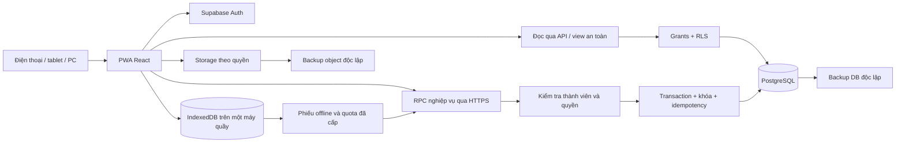

# 05 — Kiến trúc đề xuất

Trạng thái: **PLAN ONLY — chờ phê duyệt trước khi viết code, cài package, tạo database hoặc triển khai.** Ngày kiểm tra nguồn chính thức: **24/10/2026**, múi giờ Asia/Saigon. Cập nhật: người dùng đã xác nhận một cửa hàng/một kho và một máy quầy bán/in offline. Các quyết định triển khai/chính sách còn lại là đề xuất. Đọc cùng [thiết kế dữ liệu](03-DATABASE-DESIGN.md), [kế hoạch triển khai](06-IMPLEMENTATION-PLAN.md) và [kế hoạch kiểm thử](07-TEST-PLAN.md).

## 1. Phương án khuyến nghị

**Quyết định đã xác nhận ngày 24/10/2026: dùng Supabase PostgreSQL làm database trung tâm.** Các lựa chọn frontend, Auth/RLS, hosting, gói Supabase, vùng dữ liệu và mức sao lưu vẫn được trình bày để phê duyệt chi tiết; chưa tạo project hoặc kết nối dịch vụ.

Ứng dụng React + TypeScript + Vite + Tailwind CSS, giao diện tiếng Việt theo hướng Mobile First, phục vụ một cửa hàng và một kho trong MVP. Supabase cung cấp PostgreSQL, Auth, Data API/RPC và Storage khi cần ảnh. Database là nơi quyết định quyền, tồn kho, giá vốn, công nợ và trạng thái chứng từ. Frontend điều khiển nhập liệu, hiển thị và gửi yêu cầu nghiệp vụ.

`store_id` là ranh giới dữ liệu cửa hàng; `store_members` liên kết tài khoản Auth với cửa hàng, vai trò và trạng thái hoạt động. Đây là cách giới hạn truy cập từ đầu, chưa phải chức năng nhiều chi nhánh. MVP không có điều chuyển kho, phân quyền xuyên chi nhánh hoặc đồng bộ kho nhiều điểm.

| Khối | Trách nhiệm đề xuất | Giới hạn |
|---|---|---|
| React + TypeScript | Màn hình, biểu mẫu, trạng thái giỏ hàng, lỗi nhập liệu | Giá/tồn/quyền trên client không có thẩm quyền quyết định |
| Vite | Phát triển và tạo bộ file tĩnh cho hosting | Không dùng máy chủ preview cho production |
| Tailwind CSS | Quy ước bố cục, màu, chữ, responsive dùng chung | Không bổ sung hệ thống thiết kế lớn trong MVP |
| Auth | Đăng nhập, phiên người dùng | Đăng nhập thành công chưa đồng nghĩa có quyền cửa hàng |
| Data API đọc + RPC nghiệp vụ | Đọc dữ liệu được phép; một lệnh ghi hoàn chỉnh cho mỗi nghiệp vụ | Không ghép nhiều request ghi từ trình duyệt thành “transaction” |
| PostgreSQL | Ràng buộc, transaction, khóa, kho, giá vốn, công nợ, audit | Nguồn dữ liệu chuẩn duy nhất |
| Storage | Ảnh sản phẩm/tệp chứng từ theo quyền nếu đưa vào phạm vi | Không bắt buộc để chạy bán hàng MVP; không lưu ảnh giấy tờ tùy tiện |
| Manifest + Service Worker + IndexedDB | Cài đặt, tài nguyên tĩnh, dữ liệu quầy đã cấp và outbox bán offline | Một máy quầy, hạn mức riêng; chưa sync không phải POSTED trung tâm; không sync DB hai chiều |
| Hosting tĩnh HTTPS | Phân phối ứng dụng và tài nguyên tĩnh | Không chứa secret database hoặc khóa đặc quyền |

Vite xuất bản build tĩnh; tài liệu chính thức nêu `vite preview` chỉ dành cho xem trước tại máy. Đây là căn cứ chọn hosting tĩnh cho frontend. [Nguồn: Vite — Static Deploy](https://vite.dev/guide/static-deploy.html).

### Đánh giá lựa chọn

| Lựa chọn | Điểm phù hợp | Đánh đổi / kết luận |
|---|---|---|
| React + Vite + Supabase | Ít tầng vận hành; quan hệ dữ liệu phù hợp chứng từ, kho, thanh toán | **Supabase PostgreSQL đã được chọn**; frontend và chi tiết triển khai vẫn là đề xuất. Cần năng lực SQL, RLS và kiểm thử đồng thời |
| React + backend tự quản + PostgreSQL | Chủ động API và hạ tầng | Tăng việc Auth, backup, triển khai, theo dõi máy chủ; cân nhắc khi có tích hợp phức tạp hoặc yêu cầu hạ tầng riêng |
| Framework có SSR | Hữu ích cho trang công khai cần SEO hoặc xử lý phía server nhiều | Phần mềm nội bộ này chưa cần SSR; không thêm tầng chỉ để có framework lớn hơn |
| Đồng bộ toàn bộ database xuống thiết bị | Có thể phục vụ nhiều loại thao tác offline | Không chọn cho MVP; dùng IndexedDB giới hạn cho quầy và RPC ghi sổ PostgreSQL để giữ ranh giới quyền/kho |

Không cần microservices, message broker, event sourcing toàn hệ thống hoặc backend riêng trong MVP. `inventory_movements` và `party_ledger` là sổ nghiệp vụ có liên kết chứng từ, không biến toàn ứng dụng thành hệ thống sự kiện.

Nếu chọn quyền offline có chữ ký bất đối xứng, có thể cần một Supabase Edge Function hẹp để ký gói quyền bằng khóa server và xác thực thiết bị; không đặt khóa ký trong browser. Quyết định chi tiết sau thử kỹ thuật, không ngầm thêm máy chủ LAN. Một máy quầy offline không cần server tại cửa hàng trong phương án đề xuất.

## 2. Ranh giới module và dữ liệu

| Miền | Bảng liên quan | Quyền sở hữu nghiệp vụ |
|---|---|---|
| Cửa hàng, thành viên | `stores`, `store_members` | Quản trị thành viên và quyền; không cho tự nâng vai trò |
| Danh mục, đối tác | `parties`, `products`, `product_variants` | Sản phẩm thống nhất, khách hàng và nhà cung cấp |
| Đơn vị hàng, kho | `stock_units`, `unit_identifiers`, `inventory_balances`, `inventory_movements` | UUID là định danh đơn vị; IMEI/Serial là mã tra cứu có ràng buộc |
| Nhập và bán | `documents`, `purchases`, `purchase_lines`, `purchase_charges`, `sales`, `sale_lines`, `sale_line_units` | Chứng từ gốc, chi tiết, chi phí nhập và đơn vị được giao thực tế |
| Trả hàng | `returns`, `return_lines` | Liên kết dòng gốc, số lượng/đơn vị, giá vốn đảo và nghĩa vụ hoàn tiền |
| Thu chi, công nợ | `payments`, `payment_allocations`, `party_ledger` | Phân bổ tiền và đối soát công nợ theo chứng từ |
| Chi phí, hậu mãi | `device_costs`, `warranty_cases` | Chi phí theo máy và lịch sử xử lý |
| Kiểm kê và đầu kỳ | `stocktakes`, `stocktake_lines`, `inventory_adjustments`, `opening_documents`, `opening_lines` | Chênh lệch chỉ tạo biến động sau duyệt; đầu kỳ không tạo doanh thu/dòng tiền giả |
| Kiểm soát | `audit_events`, `idempotency_requests` | Truy vết và chống xử lý lặp |
| Quyền bán offline | `offline_terminals`, `offline_grants`, `offline_grant_lines`, `offline_sync_records` | Một quầy được cấp tồn riêng, đồng bộ phiếu bất biến và đối soát |

Chế độ `IMEI | QUANTITY | SERIAL` nằm trên biến thể, không đổi khi đã có phát sinh. Máy theo IMEI và hàng theo Serial đều dùng `stock_units.id` UUID; `unit_identifiers` có loại mã riêng, giá trị chuẩn hóa và unique theo `(store_id, kind, normalized_value)`. IMEI 1 và IMEI 2 cùng trỏ một đơn vị, không phải hai máy. Đề xuất unique mã định danh cần được chủ cửa hàng duyệt theo quy tắc tại tài liệu dữ liệu.

Các bảng con phải giữ đúng cửa hàng với bảng cha bằng khóa ngoại/ràng buộc thích hợp và kiểm tra trong RPC. Không coi `store_id` client gửi là bằng chứng quyền. Tồn tổng và số dư phục vụ tra cứu phải đối soát được về sổ biến động và chứng từ.

## 3. Lệnh ghi atomic, khóa và chống gửi lặp

PostgREST thực thi từng request trong transaction; PostgreSQL cung cấp tính tất cả hoặc không có gì cho các bước trong transaction. Thiết kế chọn **một POST RPC cho toàn bộ thao tác ghi sổ**, không gọi lần lượt “tạo hóa đơn”, “trừ kho”, “ghi tiền” từ frontend. [Nguồn: PostgREST — Transactions](https://docs.postgrest.org/en/stable/references/transactions.html), [PostgreSQL — Transactions](https://www.postgresql.org/docs/current/tutorial-transactions.html).

Các nhóm lệnh dự kiến gồm ghi sổ nhập, ghi sổ bán, ghi sổ trả hàng, ghi thu/chi và phân bổ, đảo chứng từ, duyệt điều chỉnh kiểm kê. Đây là hợp đồng chức năng, chưa phải API đã triển khai.

Một lệnh bán được đề xuất đi qua các bước sau trong cùng transaction:

1. Xác định người gọi từ Auth; xác nhận thành viên đang hoạt động, cửa hàng và quyền bán. Kiểm tra phiên bản hợp đồng đầu vào, định dạng, giới hạn kích thước yêu cầu.
2. Giữ yêu cầu idempotency theo khóa duy nhất `(store_id, operation, request_id)`; kiểm tra người tạo và hash payload. Cùng khóa nhưng khác nội dung phải bị từ chối, không lấy kết quả cũ rồi coi là thành công.
3. Sau kiểm tra membership và giữ idempotency, khóa phạm vi cửa hàng/kỳ/kiểm kê khi cần; chứng từ nguồn/cần tất toán; tài khoản đối tác; terminal/grant nếu có; biến thể và tồn tổng QUANTITY; cuối cùng đơn vị hàng. Sắp ID trong từng nhóm; mọi RPC dùng cùng thứ tự như tài liệu 03.
4. Đọc lại trạng thái thật sau khi có khóa. Đảm bảo từng IMEI/Serial còn được bán; tổng số lượng theo biến thể trong yêu cầu không vượt tồn; không lặp cùng đơn vị ở hai dòng. Khóa cả dữ liệu giá vốn được cập nhật.
5. Server tính tổng, chiết khấu, giá vốn, phần đã thu và công nợ. Kiểm tra quyền giảm giá/sửa giá theo chính sách được phê duyệt.
6. Ghi chứng từ, liên kết đơn vị, biến động kho, cập nhật tồn/giá vốn, thu tiền, phân bổ, sổ công nợ, audit và kết quả idempotency. Chỉ trả thành công khi transaction commit.

`FOR UPDATE` chặn các lần cập nhật xung đột trên dòng đã khóa; PostgreSQL vẫn có thể phát hiện deadlock. Vì vậy cần giữ transaction ngắn và thống nhất thứ tự khóa. Không dùng `SKIP LOCKED` để âm thầm bỏ qua máy được khách chọn. [Nguồn: PostgreSQL — Explicit Locking](https://www.postgresql.org/docs/current/explicit-locking.html).

Đề xuất tạo sẵn dòng `inventory_balances` khi tạo biến thể QUANTITY để có dòng khóa ổn định; IMEI/SERIAL dùng dòng biến thể và các unit, không có bộ số dư serialized riêng. Không chỉ khóa kết quả truy vấn “còn hàng” vì tập kết quả rỗng không khóa được đơn vị chưa tồn tại. Dùng unique/check/FK làm lớp bảo vệ bổ sung. Kiểm thử phải chứng minh hai người cùng bán máy cuối chỉ có một người thành công; hai người cùng xuất phụ kiện cuối không gây tồn âm.

Mặc định không xem mức cô lập transaction là giải pháp tự đủ: Read Committed có thể quan sát dữ liệu thay đổi giữa các câu lệnh. Nếu chọn Serializable cho một thao tác đặc biệt, phải có retry toàn transaction khi serialization failure. [Nguồn: PostgreSQL — Transaction Isolation](https://www.postgresql.org/docs/current/transaction-iso.html).

### Giao thức idempotency và lỗi không rõ kết quả

- Frontend sinh `request_id` trước lần gửi đầu, giữ nguyên cho mọi lần thử lại của cùng hành động; không sinh khóa mới vì timeout.
- Yêu cầu đang chạy giữ bản ghi/khóa idempotency trong transaction. Yêu cầu trùng đợi kết quả hoặc nhận trạng thái cần tra cứu; không chạy thêm một nghiệp vụ song song.
- Sau commit, lần gọi lại trả mã chứng từ và kết quả an toàn đã lưu. RPC tra cứu kết quả cũng phải kiểm tra người gọi và quyền, không để khóa đoán được trở thành quyền đọc.
- Nếu lỗi trước commit, toàn bộ ghi sổ rollback; lần retry cùng khóa có thể chạy lại. Frontend thể hiện “Chưa xác định kết quả”, tra cứu theo khóa trước khi đề nghị tạo giao dịch khác.
- Lỗi nghiệp vụ như hết tồn, máy đã bán hoặc payload đổi phải được người dùng xử lý; không tự retry mù. Deadlock/serialization có thể thử lại hữu hạn, cùng khóa, có độ trễ tăng dần.
- Chứng từ gốc của lệnh lưu khóa yêu cầu chống trùng bền vững; chứng từ con (hai khoản thu hoặc trả+bán khi đổi) liên kết cùng gốc, không chịu unique request_id như các lệnh độc lập. Dọn payload idempotency không được mở lại khả năng ghi trùng. Thời hạn giữ payload/kết quả tối thiểu cần thống nhất khi thiết kế chi tiết.

Quyền ghi trực tiếp của vai trò ứng dụng đối với sổ kho, tồn tổng, công nợ, tiền, giá vốn, trạng thái đã ghi sổ, audit và idempotency phải bị thu hồi. Quy tắc này áp dụng cả REST, GraphQL nếu bật, sửa qua SDK và RPC phụ. Danh mục đơn giản có thể có quyền CRUD hẹp nhưng không được thay đổi trường ảnh hưởng chứng từ đã ghi sổ.

Hủy/điều chỉnh bằng chứng từ đảo có tham chiếu, lý do và người thực hiện; không xóa giao dịch lịch sử. Trả hàng khóa dòng gốc và các lần trả liên quan để không trả vượt; dùng giá vốn gốc theo tài liệu nghiệp vụ. Hoàn tiền là dòng tiền riêng, không mặc định đã trả tiền chỉ vì hàng được nhận lại.

Không gọi in hóa đơn, gửi thông báo, upload ảnh hay API ngoài bên trong transaction server. In online sau server commit; in offline sau transaction local hoàn tất và phải ghi “chưa đồng bộ”. Tác vụ in có thể làm lại mà không ghi thêm doanh thu/thu tiền.

## 4. Auth, RLS và bảo vệ thông tin nhạy cảm

### Đăng nhập và phạm vi cửa hàng

Frontend dùng publishable key (hoặc `anon` legacy nếu dự án còn dùng) và phiên Auth của người dùng. Secret key/`service_role` có thể bỏ qua RLS nên tuyệt đối không có trong trình duyệt, bundle, repository hoặc ảnh chụp cấu hình. Tác vụ quản trị/backup tương lai dùng secret riêng trên môi trường tin cậy. [Nguồn: Supabase — API Keys](https://supabase.com/docs/guides/getting-started/api-keys).

Các biến Vite mang tiền tố công khai được đưa vào mã client. Chỉ cấu hình URL dự án và khóa được phép công khai trong frontend; tên biến môi trường không tự biến một bí mật thành an toàn. [Nguồn: Vite — Env Variables and Modes](https://vite.dev/guide/env-and-mode.html).

Thiết kế đề xuất tài khoản theo người, mời thành viên bởi chủ cửa hàng; không dùng chung mật khẩu. Vai trò cơ bản: chủ cửa hàng, nhân viên bán hàng; nhân viên kho tùy nhu cầu được duyệt ở tài liệu 01. Quyền chi tiết lấy từ ma trận tại tài liệu yêu cầu; người dùng không tự thay đổi `store_members`.

RLS giới hạn hàng theo `auth.uid()` và thành viên cửa hàng. Bật RLS cho mọi bảng ứng dụng được expose; kiểm tra cả đọc và ghi. Với view được mở qua Data API, cần cấu hình quyền rõ ràng; view `security_invoker` trên PostgreSQL 15+ có thể tuân RLS của bảng nguồn. [Nguồn: Supabase — Row Level Security](https://supabase.com/docs/guides/database/postgres/row-level-security).

Không chỉ tin vai trò trong giao diện hoặc thông tin JWT có thể chưa cập nhật sau khi đổi quyền. RPC nhạy cảm đọc membership hiện tại. Đề xuất khóa chia sẻ dòng thành viên trong lệnh ghi; thao tác khóa/thu hồi thành viên dùng khóa cập nhật tương ứng để xác định rõ thứ tự hiệu lực. Cần kiểm thử trường hợp người dùng bị thu hồi quyền khi đang mở màn hình bán.

### Quyền function là một ranh giới riêng

Ưu tiên `SECURITY INVOKER` cho truy vấn thông thường. Các lệnh ghi sổ cần cập nhật bảng mà client không được DML trực tiếp có thể dùng `SECURITY DEFINER`, với owner chuyên dụng có quyền tối thiểu và phần kiểm tra quyền trong hàm. `search_path` rỗng và tên đối tượng có schema đầy đủ là yêu cầu thiết kế. [Nguồn: Supabase — Database Functions](https://supabase.com/docs/guides/database/functions).

Mỗi function đặc quyền phải có hợp đồng bảo mật rõ:

- Thu hồi `EXECUTE` từ `PUBLIC`, `anon` và các vai trò không cần; chỉ grant đúng chữ ký function cần gọi. Quản lý cả quyền mặc định của function sẽ tạo sau này trong migration.
- Kiểm tra người gọi đã đăng nhập, membership đang hoạt động, cửa hàng, quyền thao tác, cửa hàng của mọi ID đầu vào và trạng thái chứng từ. Grant cho `authenticated` chỉ cho phép gọi; không thay kiểm tra quyền nghiệp vụ.
- Không ghép SQL động từ tên bảng/cột client gửi; không trả toàn bộ bản ghi nguồn; không nhận `actor_id`, tổng tiền hoặc giá vốn từ client làm sự thật.
- Function hỗ trợ nằm trong schema không expose khi phù hợp; tránh quyền owner mạnh hơn nhu cầu. Kiểm thử trực tiếp bằng request thủ công, không chỉ thao tác qua màn hình.

PostgreSQL cảnh báo `SECURITY DEFINER` chạy bằng quyền owner và function mới mặc định có thể được `PUBLIC` thực thi. Tạo function và giới hạn quyền trong cùng migration transaction, tránh khoảng thời gian lộ quyền. [Nguồn: PostgreSQL — CREATE FUNCTION](https://www.postgresql.org/docs/current/sql-createfunction.html). Danh sách grants phải kiểm tra thực tế vì Supabase đang thay đổi mặc định expose; không dựa vào giả định mặc định của dự án mới. [Nguồn: Supabase — Securing Your API](https://supabase.com/docs/guides/api/securing-your-api).

### Giá vốn, lợi nhuận và dữ liệu khách

**RLS không che từng cột.** Quyền cấp ở mức bảng có thể tiếp tục cho phép truy cập dù thu hồi quyền ở mức cột; phải thu hồi grant rộng trước khi cấp các cột được phép. [Nguồn: Supabase — Column Level Security](https://supabase.com/docs/guides/database/postgres/column-level-security).

Đề xuất cho ứng dụng này:

| Dữ liệu | Bề mặt đọc đề xuất | Kiểm soát bắt buộc |
|---|---|---|
| Giá bán, mô tả, tồn khả dụng | Projection chỉ chứa trường phục vụ bán hàng | Membership và RLS; không kèm cost/margin |
| Giá nhập, giá vốn từng máy, giá trị kho, lợi nhuận | RPC báo cáo kiểm tra quyền `view_cost`/`view_profit` | Không grant SELECT bảng nguồn cho mọi `authenticated`; không đưa vào response nhân viên |
| Thông tin đối tác và công nợ | RPC/view đúng nghiệp vụ và quyền | Giới hạn trường, phân trang, không mở export đại trà |
| Audit | Chủ cửa hàng hoặc người được cấp quyền audit | Hạn chế thông tin nhạy cảm trong diff; đọc theo nhu cầu |

Vai trò ứng dụng `authenticated` là vai trò database dùng chung cho nhiều nhân viên. Vì vậy column grants đơn thuần không thể biểu đạt mọi quyền động theo thành viên; dữ liệu chi phí dùng RPC có kiểm tra vai trò và projection riêng. View được cấp cho nhân viên chỉ chọn cột an toàn; nếu dùng `security_invoker`, phải đồng thời cấp quyền bảng/cột nguồn phù hợp. Không dùng view mặc định chạy quyền owner để vô tình vượt RLS.

Ẩn một ô trên UI không phải bảo vệ: phải thử select cột trực tiếp, join, RPC, báo cáo, export và lỗi trả về. Không để lộ margin qua tổng hợp khi người dùng không có quyền xem; không tính cost bằng dữ liệu tải xuống rồi giấu bằng CSS.

## 5. PWA và mất mạng

### Phạm vi đã xác nhận và phương án đề xuất

Người dùng cần bán/in khi mất Internet trên **một máy quầy được chỉ định**. Giữ PostgreSQL làm sổ trung tâm; bổ sung IndexedDB cho quyền đã cấp, hàng/giá cần bán và outbox cục bộ. Không cho mọi thiết bị dùng snapshot tồn cũ để bán. Quyền offline được chuẩn bị khi online, theo user/ca/terminal; danh sách IMEI/Serial và quota hàng lượng được server giữ riêng, không bán ở thiết bị khác. Cấp quyền không làm giảm tài sản, chỉ chuyển bucket AVAILABLE → OFFLINE_RESERVED.

Phần lớn hàng cấp cho quầy có thể tạm không bán trên mobile online; chủ cần chốt lượng cấp để cân bằng khả năng offline và tồn bán nơi khác. Chưa được cấp hàng/không chuẩn bị ứng dụng thì mất mạng chỉ có nháp, không có đường “bỏ kiểm tra tồn” cho nhân viên. Không tự hết hạn rồi tái cấp quyền: terminal có thể đã giao hàng nhưng chưa sync.

### Lưu bền và in

Giao dịch bán offline được ghi cùng quota và sequence trong một transaction IndexedDB; chờ hoàn tất rồi mới in/giao hàng. Outbox bất biến có UUID/request_id, terminal/grant, snapshot dòng và giá, tiền mặt nhận/thừa, thời gian local và hash. Web Locks có thể phối hợp nhiều tab cùng origin; transaction và ràng buộc local vẫn là nền bảo vệ số dư. Web Locks không khóa thiết bị khác hoặc trình duyệt khác. [Nguồn: MDN — IndexedDB](https://developer.mozilla.org/en-US/docs/Web/API/IndexedDB_API/Using_IndexedDB), [Web Locks](https://developer.mozilla.org/en-US/docs/Web/API/Web_Locks_API).

Phiếu in offline có mã duy nhất và nhãn **“Đã ghi nhận tại quầy — chưa đồng bộ hệ thống”**, không giả số POSTED/hoá đơn thuế. Dựng mẫu từ dữ liệu đã lưu và tài nguyên cục bộ; `window.print()` mở hộp thoại in tài liệu đang có, còn hỗ trợ máy in/driver khi mất Internet phải thử trên quầy thật. Không hứa in nhiệt/Bluetooth tự động. In lại dùng cùng phiếu. [Nguồn: MDN — Window.print](https://developer.mozilla.org/en-US/docs/Web/API/Window/print).

IndexedDB không thay backup. Đề nghị persistent storage nhưng trình duyệt có thể từ chối; người dùng xóa dữ liệu, lỗi ổ đĩa hoặc hỏng máy vẫn có thể mất outbox. Kiểm tra dung lượng, chống chế độ ẩn danh, phát hiện lỗi lưu và dừng trước bán/in; bổ sung bản sao local có kiểm soát và phục dựng bằng phiếu in/đếm tiền/hàng. Mất Internet không được giả định máy in còn hoạt động; cần chạy thử. [Nguồn: MDN — StorageManager.persist](https://developer.mozilla.org/en-US/docs/Web/API/StorageManager/persist).

### Đồng bộ có thứ tự và không tạo trùng

Một tác vụ gửi outbox theo sequence, có thể tự chạy khi mạng/phiên server hợp lệ. Chỉ gửi **phiếu đã được người bán ghi nhận**, không tự chuyển nháp thành giao dịch. RPC mỗi phiếu kiểm terminal/grant/hash/quota/policy và quyền, ghi kho/vốn/nợ/tiền/audit/ack nguyên tử bằng khóa idempotency cũ. Batch có thể thành công một phần theo từng phiếu; gặp lỗi dừng chuỗi để chủ đối soát, không bỏ qua phiếu lỗi.

ACK ghi lại mã phiếu server; request timeout tra lại cùng UUID. Không xóa bản local trước ack và thời gian lưu sau ack đã duyệt. Online pending trước mất mạng phải tra kết quả, không chuyển thành một phiếu offline UUID mới. Giao dịch bị từ chối nhưng hàng/tiền đã trao vẫn được giữ ở NEEDS_REVIEW; chủ phục hồi có tham chiếu, không chỉ “rollback giao dịch thực tế” rồi bỏ dấu.

Giá/tiền trên phiếu giữ theo quyền đã cấp; server kiểm lại thay vì áp giá mới cho khách đã trả tiền. Vốn hàng lượng theo bình quân lúc **server ghi sổ**, timestamp phát sinh tại quầy lưu riêng; không hồi tố tính lại toàn bộ lịch sử. Báo cáo trung tâm hiển thị phần chưa đồng bộ và mốc cập nhật, đóng ca đối chiếu tổng tiền local với tiền thực. Quy tắc qua kỳ khóa/ngày bán khác ngày sync phải được D02/D03 duyệt trước triển khai.

### Quyền, bảo mật cục bộ và vòng đời ứng dụng

Quầy không biết ngay việc user bị khóa trên server khi mất mạng. Đề xuất giới hạn ca/thời gian quyền và quota; không cho user mới đăng nhập offline. Không coi đồng hồ local là nguồn tin cậy để bảo đảm thu hồi quyền. Khi sync phát hiện revoked/phiên không hợp lệ thì dừng, cho chủ tiếp nhận phiếu đã có qua quy trình đối soát, không cho tài khoản bị khóa tiếp tục gọi RPC đặc quyền. Sao chép profile/khôi phục backup trình duyệt không tạo terminal thứ hai hợp lệ; server vẫn kiểm trùng quyền và phiếu, rủi ro giao hàng vật lý ngoài quy trình phải được chủ hiểu rõ.

Cache Storage Service Worker chỉ allowlist static; không cache tự động Auth/REST/RPC, danh bạ, báo cáo hoặc chi phí. IndexedDB là kho dữ liệu nghiệp vụ có chủ đích: có **giá bán và tiền trên phiếu chưa sync** vì cần giữ giao dịch thật, không chứa cost/margin hoặc service key. Chỉ giữ hàng/quyền quầy cần, không tải toàn bộ dữ liệu khách. Offline đề xuất bán tiền mặt trả đủ; mở nợ/chuyển khoản cần đặc tả riêng. [Nguồn: MDN — PWA Caching](https://developer.mozilla.org/en-US/docs/Web/Progressive_web_apps/Guides/Caching).

Nháp có thể xóa theo quy tắc; outbox chưa ack thì không. Logout, đổi user, xóa thiết bị hoặc cập nhật schema phải kiểm outbox và cho quy trình bàn giao/đồng bộ, không tự clear tất cả dữ liệu. Khóa truy cập local theo user/ca, thiết bị bảo vệ bằng khóa màn hình/ổ đĩa; PWA không được mô tả như chống được người có toàn quyền trên máy. SW update phải tương thích phiên bản local và giữ outbox, không ép reload/đổi schema giữa lúc lưu hay in. [Nguồn: MDN — Service Worker lifecycle](https://developer.mozilla.org/en-US/docs/Web/API/Service_Worker_API/Using_Service_Workers).

| Tình huống | Hành vi đề xuất |
|---|---|
| Mất Internet, quầy có quyền và quota | Bán tiền mặt trong hạn mức, lưu local hoàn tất rồi in chưa đồng bộ |
| Thiết bị khác hoặc quầy chưa chuẩn bị | Chỉ nháp, không bán từ tồn cũ |
| Hết quota/không có unit được cấp | Dừng bán hàng đó, cần online để cấp bổ sung |
| Đã gửi online nhưng chưa rõ kết quả | Tra đúng request_id, không tạo phiếu offline mới |
| Lưu local lỗi/hết dung lượng | Dừng trước nhận tiền/giao hàng/in; không báo đã ghi nhận |
| In lỗi/hết giấy | Giữ phiếu local; in lại cùng mã |
| Kết nối lại | Gửi tuần tự phiếu đã ghi nhận, kiểm ack và quota; nháp cần người xác nhận |
| Quyền bị thu hồi hoặc dữ liệu lệch | Dừng giao dịch mới, bảo toàn outbox, chủ đối soát phần đã thực hiện |
| Hỏng/mất quầy | Không tự release quota; kiểm phiếu/tiền/hàng và ngừng sử dụng bản máy cũ trước cấp lại |

Quét camera là bổ trợ; luôn có nhập tay và máy quét bàn phím. `BarcodeDetector` có giới hạn hỗ trợ nên không là điều kiện để bán. [Nguồn: MDN — BarcodeDetector](https://developer.mozilla.org/en-US/docs/Web/API/BarcodeDetector).

## 6. Hosting, môi trường và chi phí

Ưu tiên frontend tĩnh trên HTTPS; database Supabase đã được chọn, vùng dữ liệu sẽ chốt sau khi đo độ trễ bằng thiết bị/mạng cửa hàng. Nhà cung cấp hosting frontend và gói Supabase còn cần xác nhận.

| Phương án frontend | Kết quả kiểm tra 24/10/2026 | Khuyến nghị |
|---|---|---|
| Cloudflare Pages | Có gói Free và giới hạn build/tài nguyên công bố | Ứng viên tiết kiệm cho frontend tĩnh; kiểm tra plan và điều khoản áp dụng trước production |
| Cloudflare Workers Static Assets | Tài liệu công bố request tới static assets miễn phí; Worker code có cách tính riêng | Phương án thay thế khi cần hướng triển khai này; không thêm Worker backend nếu chưa có nhu cầu |
| Vercel Hobby | Điều khoản giới hạn cá nhân/phi thương mại | **Không chọn làm giả định hosting miễn phí cho cửa hàng** |
| Vercel Pro hoặc hosting tĩnh trả phí phù hợp | Vercel Fair Use nêu thương mại cần Pro/Enterprise | Phương án có ngân sách rõ nếu không chốt Cloudflare; kiểm tra giá, usage và điều khoản lúc mua |

Nguồn: [Cloudflare Pages — Limits](https://developers.cloudflare.com/pages/platform/limits/), [Workers Static Assets — Billing](https://developers.cloudflare.com/workers/static-assets/billing-and-limitations/), [Vercel — Fair Use](https://vercel.com/docs/limits/fair-use-guidelines), [Vercel — Terms, mục Hobby](https://vercel.com/legal/terms).

Đã đọc [Cloudflare Self-Serve Agreement](https://www.cloudflare.com/terms/) và [Service-Specific Terms](https://www.cloudflare.com/service-specific-terms-application-services/). Không tìm thấy trong các trang đã kiểm tra một tuyên bố riêng cho Pages Free khẳng định quyền dùng thương mại; do đó đánh dấu **chưa xác minh đầy đủ điều khoản cho cấu hình tài khoản cụ thể**, không diễn giải “Free” thành cam kết sử dụng thương mại không điều kiện. Điều khoản Free có thể thay đổi/chấm dứt theo nhà cung cấp. Chốt nhà cung cấp là quyết định cần xác nhận trước giai đoạn triển khai.

Về Supabase, Free phù hợp thử nghiệm có dữ liệu giả nhưng có giới hạn tài nguyên; tài liệu billing nêu dự án trả phí không bị pause như Free. Đề xuất cân nhắc gói có backup và hỗ trợ vận hành phù hợp cho dữ liệu bán hàng thật, thay vì mặc định toàn hệ thống miễn phí. Chưa chốt giá tiền vì chi phí còn phụ thuộc project, compute, storage, egress, backup và PITR. [Nguồn: Supabase — Billing](https://supabase.com/docs/guides/platform/billing-on-supabase).

### Môi trường và pipeline dự kiến sau khi được phê duyệt

- **Local/dev:** dữ liệu giả; schema và policy có thể tạo lại bằng migration. Không kéo dữ liệu khách hàng thật về máy lập trình tùy tiện.
- **Staging:** Supabase project riêng và domain riêng, tách Auth/Storage/keys; chạy nghiệm thu, kiểm thử hai phiên và phục hồi. Nếu ngân sách không đủ staging luôn hoạt động, môi trường thử có thể tạo theo đợt; không dùng chung production database.
- **Production:** chỉ người phụ trách được thay cấu hình; mời thành viên đúng quy trình. Preview frontend không được tự trỏ vào production.

Mọi schema, constraint, function, grant và RLS được version hóa bằng migration khi bước vào giai đoạn code; hạn chế sửa tay Dashboard gây lệch môi trường. Supabase hỗ trợ theo dõi thay đổi schema qua migration và thử ở local trước khi đẩy lên dự án. [Nguồn: Supabase — Database Migrations](https://supabase.com/docs/guides/local-development/database-migrations).

Pipeline tương lai: kiểm tra định dạng/type → kiểm thử nghiệp vụ DB và RLS → dựng DB trống từ migration → kiểm thử đồng thời/idempotency → build frontend → staging và nghiệm thu → backup/kiểm tra tương thích → migration production có kiểm soát → phát hành frontend → smoke test. Đây là kế hoạch, chưa tạo pipeline hoặc chạy lệnh nào.

Migration ưu tiên thêm trường/chức năng tương thích trước, chuyển frontend sau, dọn cấu trúc cũ ở đợt tiếp theo. Rollback frontend không được giả định có thể rollback dữ liệu kinh doanh; lỗi schema cần kế hoạch sửa tiến hoặc phục hồi đã diễn tập. Phiên PWA cũ phải nhận lỗi phiên bản rõ ràng nếu không còn tương thích.

## 7. Sao lưu và phục hồi

Supabase công bố backup hằng ngày cho các gói trả phí được liệt kê; Free được khuyến nghị tự export bằng CLI và lưu ngoài dịch vụ. Backup database không chứa file Storage, chỉ metadata. PITR là add-on cho các gói đủ điều kiện, yêu cầu compute tối thiểu theo tài liệu; không có cơ sở coi PITR mặc định miễn phí. [Nguồn: Supabase — Database Backups](https://supabase.com/docs/guides/platform/backups).

### Các thành phần phải có trong bộ phục hồi đề xuất

| Thành phần | Cách chuẩn bị trong giai đoạn triển khai | Kiểm chứng |
|---|---|---|
| Dữ liệu, schema ứng dụng, function, RLS, grants | Backup quản lý + logical export độc lập, mã hóa và lưu ngoài tài khoản đang vận hành | Khôi phục thử; kiểm tra chứng từ/sổ/constraint/quyền |
| Roles và quyền | Export phù hợp, tài liệu owner/grant; bí mật lưu trong kho bí mật | Tạo lại quyền đúng, không vô tình mở `PUBLIC` |
| Auth | Kiểm tra dữ liệu người dùng được export, custom triggers, cấu hình provider/URL/email và secrets cần dựng lại | Người dùng thử đăng nhập/reset và đúng membership |
| Storage | Sao chép object, đường dẫn, bucket, metadata và policy; có danh sách/checksum theo bản backup | Tải được file, quyền đọc/ghi đúng, không có metadata trỏ file mất |
| Cấu hình hosting và ứng dụng | Domain, redirect Auth, biến môi trường, phiên bản ứng dụng và migration | Mở ứng dụng đúng môi trường, RPC và đăng nhập hoạt động |
| Nhật ký bản sao | Thời điểm, phiên bản, snapshot/phạm vi, checksum, kết quả job | Biết bản nào hợp lệ và điểm dữ liệu phục hồi |
| Outbox/quota máy quầy | Bản sao local được phép, danh sách UUID/sequence/ack và phiếu in; không giả định cloud backup chứa giao dịch chưa sync | Khôi phục khi không có mạng và khi cloud đã rollback về mốc cũ, không reset quota hoặc thu tiền lại |

Hướng dẫn CLI của Supabase tách roles/schema/data; yêu cầu xử lý mật khẩu custom role và khôi phục riêng một số tùy biến `auth`/`storage`. Có các lưu ý về owner, grant và trigger trong quá trình restore, nên không sao chép một lệnh `pg_dump` chung rồi mặc định đã sao lưu toàn bộ nền tảng. Quy trình cụ thể phải thử trên phiên bản CLI và PostgreSQL được chọn. [Nguồn: Supabase — Backup and Restore using CLI](https://supabase.com/docs/guides/platform/migrating-within-supabase/backup-restore).

Logical dump và PITR có mục đích khác nhau: export độc lập giúp kiểm tra tính di chuyển/phục hồi ngoài dự án; PITR giảm khoảng mất dữ liệu database khi đủ ngân sách. Cả hai vẫn cần bản sao Storage phù hợp. Không bảo đảm một snapshot DB đồng thời tuyệt đối với upload đang diễn ra; đề xuất ảnh dùng đường dẫn bất biến, giữ phiên bản và đối chiếu manifest; khi lấy mốc phục hồi phải kiểm tra file nào phát sinh trước/sau mốc đó.

### RPO/RTO đề xuất — cần chủ cửa hàng xác nhận

RPO là khoảng dữ liệu có thể mất tính đến bản phục hồi; RTO là thời gian mục tiêu để có thể vận hành trở lại. **Các số sau là mục tiêu đề xuất, chưa đo và không phải SLA của nhà cung cấp.**

| Lựa chọn | Mục tiêu đề xuất | Điều kiện và đánh đổi |
|---|---|---|
| Ngân sách tối thiểu | RPO không quá 24 giờ; RTO 1 ngày làm việc | Export DB + Storage mỗi ngày; có thể phải nhập lại cả ngày bán. Chỉ chấp nhận khi chủ cửa hàng xác nhận rõ mức mất dữ liệu này |
| Vận hành khuyến nghị | RPO DB/Storage không quá 1 giờ; RTO không quá 4 giờ trong giờ hỗ trợ | Cần thiết kế tần suất export/sao chép và giám sát đủ đáp ứng, đo tải và diễn tập; kiểm tra PITR nếu chọn. Chi phí cao hơn |

Không tự cam kết RPO 1 giờ chỉ vì có daily backup hoặc có PITR. Nếu thử nghiệm không đạt mục tiêu hoặc ngân sách không phù hợp thì phải đổi phương án/mục tiêu trước khi dùng dữ liệu thật. Đề xuất retention ban đầu: 7 bản ngày và 4 bản tuần, có bản ngoài tài khoản vận hành, cần xác nhận theo dung lượng, tính nhạy cảm và yêu cầu lưu lịch sử.

**Local là một ranh giới phục hồi riêng:** đề xuất xuất bản sao outbox có kiểm soát ra thiết bị/vị trí khác mỗi 15 phút hoặc 5 phiếu (mốc nào đến trước) khi đang offline, kèm phiếu in và đối soát cuối ca. Đây là quy trình cần thử và chủ duyệt, không mặc định PWA có quyền ghi file nền. Nếu máy hỏng trước lần sao tiếp theo, có thể phải phục dựng bằng phiếu/tiền/hàng; không hứa RPO local bằng 0. Chốt tần suất, mã hóa, retention, người thao tác và thời gian dựng lại quầy trong D09/D10; thiếu giải pháp backup local khả thi thì chưa go-live tính năng offline.

### Diễn tập phục hồi trước khi chạy thật

1. Chọn bản backup đã ghi nhận thời điểm và checksum; khôi phục vào môi trường cách ly, không ghi đè production để thử.
2. Dựng roles, schema, data, function, RLS/grants và các tùy biến nền tảng theo thứ tự đã kiểm chứng; dựng lại Storage và cấu hình Auth/hosting liên quan.
3. Đối chiếu số chứng từ, tồn theo đơn vị/số lượng, tổng biến động, công nợ, phân bổ tiền và giá vốn của mẫu giao dịch. Kiểm tra file và đăng nhập sau restore.
4. Dùng vai trò nhân viên thử truy cập trái quyền và RPC; xác nhận membership, cost/margin và audit vẫn được bảo vệ.
5. Ghi thời gian thực tế, dữ liệu không phục hồi được, bước phải làm thủ công và kết luận đạt/không đạt RPO/RTO. Đề xuất diễn tập mỗi quý và sau thay đổi lớn.

Trước cutover thật phải có người chịu trách nhiệm, thời điểm khóa ghi, bản sao trước chuyển đổi và quy trình quay lại. Sau phục hồi không tự gửi lại các nháp cũ: đối soát `request_id` với dữ liệu đã khôi phục và chứng từ thực tế, vì giao dịch sau mốc phục hồi có thể còn tồn tại ngoài hệ thống dưới dạng hóa đơn/tiền đã thu.

Khi restore cloud có quầy offline, phải **dừng bán cả quầy và thiết bị online bằng quy trình vận hành**, đối soát grant/UUID/sequence/ack với snapshot mới; quầy chưa biết cloud restore vẫn có thể giữ quyền cũ. Không mở lại tồn hoặc cấp grant mới trước khi kiểm phiếu đã giao và tiền thực. Bản sao profile cũ không phải quyền tiếp tục bán; phải hòa giải quota trước. Diễn tập riêng cloud mất các phiếu đã từng ack và local còn phiếu chưa ack, bao gồm trường hợp hỏng local đồng thời.

## 8. Nhật ký, giám sát và tiêu chí kiến trúc

`audit_events` ghi người thao tác, cửa hàng, nghiệp vụ, đối tượng, mã chứng từ, thời gian server, request ID, lý do và thay đổi cần thiết; tạo cùng transaction với nghiệp vụ thành công. Nhân viên không được sửa/xóa audit. Không ghi token, mật khẩu, khóa dịch vụ hoặc toàn bộ payload khách hàng vào log. Đối với thông tin nhạy cảm, lưu tham chiếu hoặc giá trị che bớt, giới hạn quyền đọc.

Theo dõi lỗi ghi sổ, timeout/deadlock, request trùng, lỗi quyền, backup thất bại, dung lượng, độ trễ và đối soát lệch. Lỗi nghiệp vụ không nên gửi toàn bộ tên/số điện thoại/IMEI vào dịch vụ theo dõi bên ngoài. Thiết lập ngưỡng cảnh báo và người xử lý khi triển khai; chưa tạo dịch vụ giám sát trong PLAN.

Kiến trúc được nghiệm thu khi: không bán trùng/âm tồn trong kiểm thử online và quota offline; retry/sync không tạo trùng; server không ghi một phần phiếu; local lưu hoàn tất trước in; tiền/hàng chưa sync được đối soát; không giải phóng quota chưa rõ; nhân viên không lấy cost/profit qua API; diễn tập phục hồi cả cloud và outbox đạt. Hiệu năng đo trên mạng/thiết bị cửa hàng.

## 9. Quyết định còn mở và giới hạn xác minh

- Chủ cửa hàng phê duyệt ma trận quyền; ai xem giá vốn/lợi nhuận, giảm giá, hủy/đảo, hoàn tiền và duyệt chênh lệch kiểm kê.
- Chốt hosting, ngân sách production/staging, vùng Supabase, gói backup, RPO/RTO và người chịu trách nhiệm khi có sự cố. Điều khoản thương mại Cloudflare cho cấu hình cụ thể chưa xác minh đầy đủ; Vercel Hobby đã được xác minh không phù hợp giả định sử dụng cửa hàng.
- Đã chốt một quầy offline; còn cần model/browser/máy in, hạn mức hàng, phiên/ca, thanh toán offline, giá chính sách snapshot, dữ liệu local, retention và phục hồi outbox. Dữ liệu tiền bán offline phải lưu có kiểm soát, không được xóa cùng nháp.
- Chốt phương pháp giá vốn phụ kiện, xử lý trả hàng/chi phí sau bán và khóa kỳ theo các tài liệu nghiệp vụ. Kiến trúc hỗ trợ kiểm soát, không tự quyết thay chính sách kế toán của cửa hàng.
- Chưa kiểm tra bằng triển khai thật: phiên bản PostgreSQL/Supabase được cấp, quyền mặc định thực tế, trình duyệt mục tiêu, tốc độ mạng, thời gian restore và chi phí hóa đơn. Nguồn web là căn cứ lựa chọn, không thay kiểm thử nghiệm thu.

Các nguồn được gắn ngay cạnh kết luận có liên quan; toàn bộ nguồn trong tài liệu là tài liệu chính thức đã truy cập ngày **24/10/2026**. Đây là tài liệu kiến trúc và nghiên cứu tích hợp, không phát sinh file research thứ chín và không thực thi bất kỳ bước triển khai nào.
